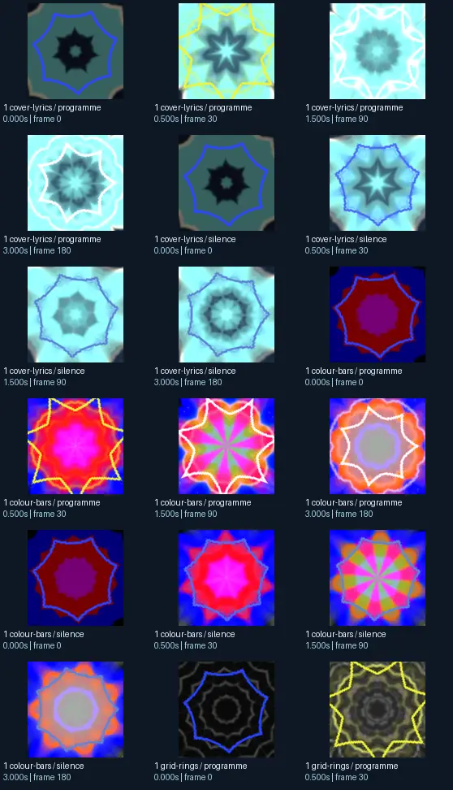
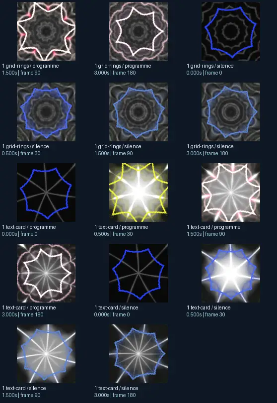

# Hexcollie - Personal Mashup3 [Flexi′s portal mix]

- Identity: `butterchurn:81680c63a79649b42dc479438fa08f6a0f8388394fec57feb513ab748a282acb`
- Engine: butterchurn
- Status: **complete**

## What this preset does across the tested inputs

Observed 32 paired source/output measurements across 8 declared conditions, including 2 cover/lyric conditions and output times 0, 0.5, 1.5, 3 seconds.

Across input families, colour-bars: hue divergence median 0.367 bits, texture divergence median 0.715 bits across 8 observed pairs; cover-lyrics: hue divergence median 0.414 bits, texture divergence median 0.448 bits across 8 observed pairs; grid-rings: hue divergence median 0.980 bits, texture divergence median 0.325 bits across 8 observed pairs; text-card: hue divergence median unavailable bits, texture divergence median 0.580 bits across 8 observed pairs.

## Repeated model interpretations (not verified facts)

Repeated model-generated captions included a blue and black flower with a circular design (3 frames); a blue and white star with a black background (3 frames); a blue and brown circular pattern (2 frames). Frequent prompt-relative hypotheses: light: soft diffuse lighting (17/32 frames); material: smooth digital surfaces (24/32 frames); medium: a 3D render (23/32 frames); setting: an abstract composition (23/32 frames); tone: a tense ominous image (12/32 frames). Frequent optional PixelCue tag hypotheses: FaceIdentity (4), blue (1), In the center of the image there is a fractal. (1), unanswerable (1), blue-light-reflecting-spiral (1).

## Changes over time

For successive captures of the same input condition, median measured texture divergence was 0.015 bits across 24 transitions.

## Music versus silence

16 matched programme-versus-silence comparisons had median hue divergence 0.148 bits. Differences may also reflect unseeded projectM rendering or feedback evolution, not just musical response.

## Complete capture overview

## Per-input quantitative responses

- **colour-bars** (8 paired observations): median hue divergence 0.3670684300731338, texture divergence 0.7154579828778715 bits
- **cover-lyrics** (8 paired observations): median hue divergence 0.413533149304287, texture divergence 0.44848403501943074 bits
- **grid-rings** (8 paired observations): median hue divergence 0.9797298140381231, texture divergence 0.32470509281509746 bits
- **text-card** (8 paired observations): median hue divergence None, texture divergence 0.5801826744969102 bits

## Individual caption hypothesis
a blue and brown circular pattern

## Prompt-relative visual characteristics
- medium: a vector illustration
- light: soft diffuse lighting
- material: metallic surfaces
- tone: a tense ominous image
- setting: outer space

## Tag hypotheses
NSFW, FaceIdentity, blue, In the center of the image there is a fractal., unanswerable, blue-light-reflecting-spiral

## OCR hypotheses
rr

## Controlled visual response

- hue_js_divergence_bits: median 0.4497 (n=24); range 0.1265–1.0000
- texture_lbp_js_divergence_bits: median 0.4485 (n=32); range 0.0564–0.7728
- saturation_absolute_difference: median 0.0932 (n=32); range 0.0185–0.4092

## Evidence limits
PixelCue features quantify sampled rasters, not subjective quality or creative intention. BLIP captions, CLIP prompts and VLM tags are fallible per-frame hypotheses. Still frames cannot establish flash safety or perceived motion quality. Only an authenticated artist-provided suite can establish behaviour on actual album audio.
- Semantic captions, tags and prompts are model hypotheses, not verified facts.
- Static captures cannot establish motion comfort, flash safety or artistic intent.
- Renderer/GPU-dependent results require validation on the target system.
