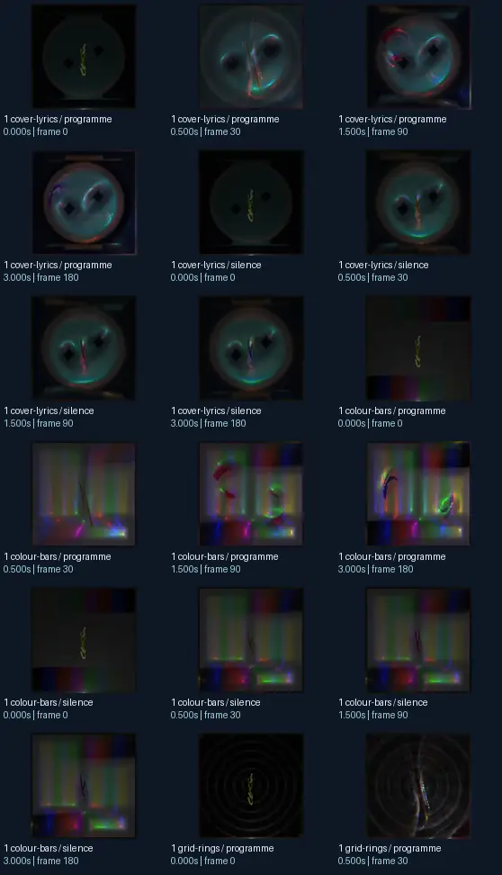
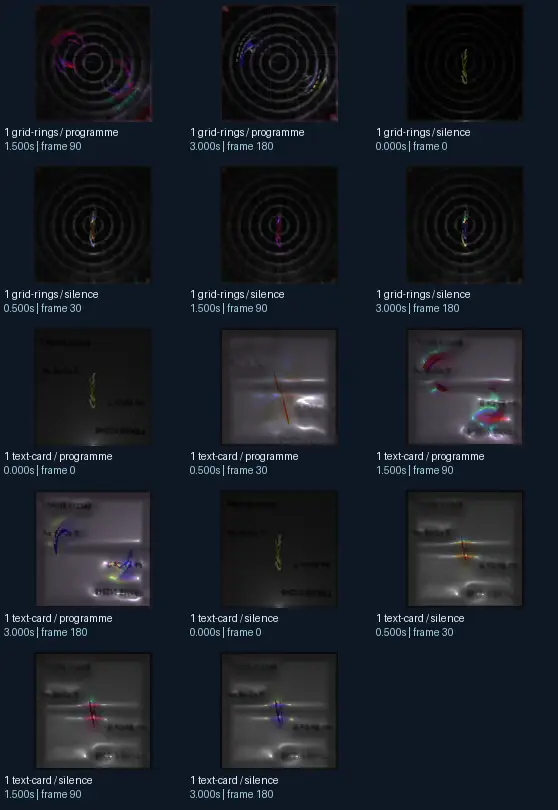

# Eo.S. + flexi - glowsticks v2 05 and proton lights (+Krash′s beat code) _Phat_remix02b + illumination (Stahl′s Mix)

- Identity: `butterchurn:2c2ffd3521b8590fb1c4b0ea8a3b3cc5ef8620d4fb5c0a6024647e2fa17c8af4`
- Engine: butterchurn
- Status: **complete**

## What this preset does across the tested inputs

Observed 32 paired source/output measurements across 8 declared conditions, including 2 cover/lyric conditions and output times 0, 0.5, 1.5, 3 seconds.

Across input families, colour-bars: hue divergence median 0.177 bits, texture divergence median 0.504 bits across 8 observed pairs; cover-lyrics: hue divergence median 0.238 bits, texture divergence median 0.319 bits across 8 observed pairs; grid-rings: hue divergence median 0.623 bits, texture divergence median 0.137 bits across 8 observed pairs; text-card: hue divergence median unavailable bits, texture divergence median 0.379 bits across 8 observed pairs.

## Repeated model interpretations (not verified facts)

Repeated model-generated captions included a black background (3 frames); a black and white photo of a light (3 frames); a clock with a green face and a black face (2 frames). Frequent prompt-relative hypotheses: light: soft diffuse lighting (26/32 frames); material: smooth digital surfaces (32/32 frames); medium: a 3D render (25/32 frames); setting: an abstract composition (27/32 frames); tone: a tense ominous image (29/32 frames).

## Changes over time

For successive captures of the same input condition, median measured texture divergence was 0.011 bits across 24 transitions.

## Music versus silence

16 matched programme-versus-silence comparisons had median hue divergence 0.164 bits. Differences may also reflect unseeded projectM rendering or feedback evolution, not just musical response.

## Complete capture overview

## Per-input quantitative responses

- **colour-bars** (8 paired observations): median hue divergence 0.17728500417099982, texture divergence 0.5042448296638697 bits
- **cover-lyrics** (8 paired observations): median hue divergence 0.23767960555547094, texture divergence 0.31946294910993345 bits
- **grid-rings** (8 paired observations): median hue divergence 0.6227803599625156, texture divergence 0.13690170786801603 bits
- **text-card** (8 paired observations): median hue divergence None, texture divergence 0.37931746701825997 bits

## Individual caption hypothesis
a clock with a green face and a black face

## Prompt-relative visual characteristics
- medium: a 3D render
- light: neon lighting
- material: smooth digital surfaces
- tone: a tense ominous image
- setting: an abstract composition

## Tag hypotheses
NSFW., NSFW

## OCR hypotheses
wld ise Ab y/) y) yi)

## Controlled visual response

- hue_js_divergence_bits: median 0.2377 (n=24); range 0.0286–0.8712
- texture_lbp_js_divergence_bits: median 0.3195 (n=32); range 0.0575–0.5786
- saturation_absolute_difference: median 0.1432 (n=32); range 0.0056–0.3677

## Evidence limits
PixelCue features quantify sampled rasters, not subjective quality or creative intention. BLIP captions, CLIP prompts and VLM tags are fallible per-frame hypotheses. Still frames cannot establish flash safety or perceived motion quality. Only an authenticated artist-provided suite can establish behaviour on actual album audio.
- Semantic captions, tags and prompts are model hypotheses, not verified facts.
- Static captures cannot establish motion comfort, flash safety or artistic intent.
- Renderer/GPU-dependent results require validation on the target system.
